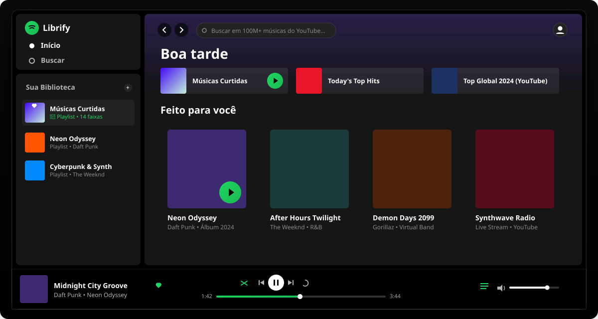

<p align="center">
  
</p>

<h1 align="center">Librify</h1>

<p align="center">
  <b>Open-source 1:1 Spotify Web Player clone with Web Audio API, balanced distributed shuffle, dual-queue priority, and live YouTube streaming engine with zero database dependencies.</b>
</p>

<p align="center">
  An authentic, high-fidelity reverse-engineered Spotify experience built on modern web standards.<br>
  No advertisements, no track skips limit, zero audio interruptions during route navigation, and instant access to over 100M+ songs.
</p>

<p align="center">
  <a href="LICENSE"></a>
  
  
  
  
  
  <a href="#architecture"></a>
</p>

<p align="center">
  <a href="#spotify-vs-librify"><b>Spotify vs Librify</b></a> ·
  <a href="#architecture"><b>Architecture</b></a> ·
  <a href="#audio-engine"><b>Audio Engine</b></a> ·
  <a href="#queue-and-shuffle"><b>Queue & Shuffle</b></a> ·
  <a href="#youtube-engine"><b>YouTube Engine</b></a> ·
  <a href="#database-schema"><b>Database Schema</b></a> ·
  <a href="#getting-started"><b>Get Started</b></a> ·
  <a href="#shortcuts"><b>Shortcuts</b></a>
</p>

<br>

<p align="center">
  
</p>

<p align="center"><sub><i>Librify Web Player</i>: Pitch-black background (`#121212`), persistent shell architecture, drag-and-drop seek bar, real-time volume sync, dynamic queue drawer, and gapless audio playback across all route changes.</sub></p>

> [!NOTE]
> **Librify is a 100% free and open-source project.** All features that require a paid Spotify Premium subscription (unlimited skips, on-demand song selection, ad-free listening, zero forced shuffle, and high quality audio) are unlocked for everyone forever with zero database maintenance required.

<br>

---

## ⚡ Spotify vs Librify

| Feature | Spotify Free | Spotify Premium | Librify (Open Source) |
| :--- | :---: | :---: | :---: |
| **Pricing** | Free (Ad-supported) | R$ 21,90+/mês | **100% Free Forever (MIT)** |
| **Ads & Audio Interruption** | Audio & Banner Ads | Ad-Free | **Zero Ads Ever** |
| **Track Selection** | Forced Shuffle Only | On-Demand | **✅ Full On-Demand Control** |
| **Track Skips** | 6 skips per hour | Unlimited | **✅ Unlimited Skips** |
| **Dynamic Priority Queue** | Limited | Supported | **✅ Dual-Queue (FIFO Priority + Context)** |
| **Music Catalog Source** | Proprietary DRM | Proprietary DRM | **✅ Global YouTube Engine (100M+ tracks)** |
| **Self-Hosted Storage** | N/A | N/A | **Zero Cloud Storage Cost (No DB required)** |
| **Telemetry & Trackers** | Extensive tracking | Extensive tracking | **100% Private, Zero Tracking** |

<br>

---

## 🏛️ Architecture

Librify was engineered with a **Persistent Shell Architecture** modeled after clean-room reverse engineering of the Spotify Web App. The audio stream and playback controller are decoupled from React route lifecycles:

```
┌────────────────────────────────────────────────────────────────────────┐
│                        Librify Persistent Shell                        │
│             (Root Layout: Sidebar + Persistent Audio Engine)           │
└───────────────────────────────────┬────────────────────────────────────┘
                                    │
          ┌─────────────────────────┼─────────────────────────┐
          ▼                         ▼                         ▼
┌──────────────────┐      ┌──────────────────┐      ┌──────────────────┐
│   Dynamic View   │      │ Global Zustand   │      │ Audio Controller │
│     (Children)   │      │   Player Store   │      │   (Singleton)    │
│ • Home (Top Hits)│      │ • userQueue[]    │      │ • Dual HTML5     │
│ • Search (Live)  │      │ • contextQueue[] │      │ • Web Audio Graph│
│ • Playlist View  │      │ • isShuffle      │      │ • MediaSession   │
│ • Artist View    │      │ • isSeeking      │      │ • Headless YT    │
└──────────────────┘      └──────────────────┘      └──────────────────┘
```

<br>

---

## 🎧 Audio Engine & Gapless Playback

- **Route Transition Continuity:** Navigating from `/` to `/search` or `/playlist/[id]` updates only the central viewport (`app-main`). The audio node is never unmounted, ensuring music **never stops** during browsing.
- **Dual-Node Preloading Pipeline:**
  - **Slot A (Active):** Drives the current track with Web Audio API `GainNode` integration.
  - **Slot B (Preload):** Automatically pre-buffers the next track in the queue 15 seconds before the current track ends.
  - **Zero Gap Handoff:** Transitions immediately between tracks without buffering delay or clicks.
- **OS MediaSession API:** Synchronizes album artwork, track title, and hardware controls (headphones, keyboard media keys, and lock screen widgets) directly with the host operating system.

<br>

---

## 🔀 Dynamic Queue & Balanced Shuffle

Librify accurately reproduces Spotify's proprietary queue management and non-clustering shuffle behavior:

### 1. Dual-Queue Priority System
- **`userQueue` (Manual Queue - FIFO):** Tracks added via the `+` button take absolute priority.
- **`contextQueue` (Context Queue):** The base playlist, album, or radio currently playing.
- **Next Track Dispatch Formula:**
  $$\text{NextTrack} = \begin{cases} \text{userQueue.shift()}, & \text{if } \text{userQueue.length} > 0 \\ \text{contextQueue}[\text{contextIndex} + 1], & \text{otherwise} \end{cases}$$

### 2. Balanced Anti-Clustering Shuffle (Dithered Jitter)
A pure random shuffle (Fisher-Yates) causes tracks from the same artist to clump together. Librify clusters tracks by artist, computes ideal spacing ($D \approx N/K$), applies a Gaussian dither, and performs disambiguation swapping so the listener never hears back-to-back tracks from the same artist unless desired.

<br>

---

## 🔴 Live YouTube Streaming Engine (Zero DB Overhead)

Librify integrates a lightweight, open-source streaming engine that directly queries and streams audio from YouTube without requiring audio files to be stored in a database:

- **Zero API Keys:** Uses `yt-search` to query titles, artists, durations, thumbnails, and stream identifiers in real time.
- **Headless YouTube Player:** An invisible headless player host initialized in the persistent shell layout.
- **Anti-403 Stability:** By utilizing official iframe event dispatching instead of fragile MP3 scrapers, playback avoids YouTube IP bans or expired signature tokens.
- **Full Scrubber Sync:** Progress bar seek, volume, play/pause, and track auto-advance operate seamlessly across both YouTube tracks and local audio.

<br>

---

## 🗄️ Relational Database Schema (Optional Supabase / PostgreSQL)

For deployments that want user profiles, collaborative playlists, and saved libraries, Librify includes a production-ready relational schema in [`supabase/schema.sql`](supabase/schema.sql):

- **`profiles`:** User accounts mirrored with Supabase Auth.
- **`artists`, `albums`, `tracks`:** Normalized music entities with `track_artists` many-to-many relationship.
- **`playlist_tracks`:** Ordered with `DOUBLE PRECISION position` supporting **LexoRank** drag-and-drop reordering without mass row updates.
- **`pg_trgm` GIN Indexes:** Full-text trigram indexing for sub-10ms search queries.
- **Row-Level Security (RLS):** Granular policies protecting private vs public playlists and liked songs.

<br>

---

## 🚀 Get Started

### Prerequisites
- **Node.js** 18+ (Node.js 20 LTS or 22 recommended)
- **npm** 9+

### Quick Start
```bash
# 1. Clone the repository
git clone https://github.com/rickystudios-hub/Librify.git
cd Librify

# 2. Install dependencies
npm install

# 3. Start development server
npm run dev
```

Open [http://localhost:3000](http://localhost:3000) in your browser.

### Production Build
```bash
npm run build
npm run start
```

<br>

---

## ⌨️ Shortcuts & Controls

| Shortcut / Action | Functionality |
| :--- | :--- |
| **Click Play on Any Card** | Starts playback immediately with context queue |
| **Drag Seek Bar** | Smoothly updates audio playback to the exact released position |
| **Volume Slider** | Instant volume gain adjustment with mute toggle |
| **List Icon (Queue)** | Opens the interactive Queue Drawer showing manual & upcoming tracks |
| **Plus Icon (+)** | Adds any song to the top-priority user queue |
| **Search Input** | 300ms debounced live YouTube query with AbortController |

<br>

---

## 🤝 Community & Contributing

Contributions, issues, and feature requests are welcome!
- Feel free to check the [issues page](https://github.com/rickystudios-hub/Librify/issues).
- Fork the repository, create your feature branch, and submit a Pull Request.

---

## 📄 License

This project is licensed under the **[MIT License](LICENSE)**. Free to use, modify, distribute, and build upon.
